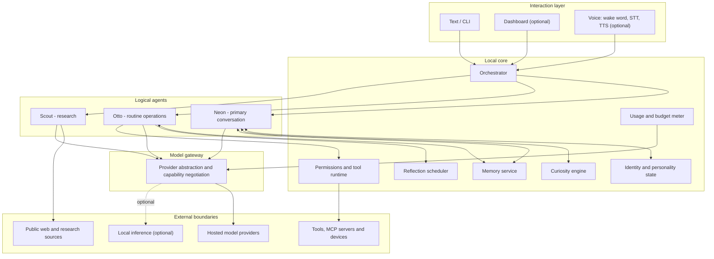

# Bunny.ai

**An open-source personal AI that grows with you.**

Bunny is a hardware-independent, provider-agnostic personal assistant built around a
simple idea: your assistant should belong to you. Your hardware, your choice of
intelligence, your memories, your Bunny.

> **Project status: pre-release, documentation-only foundation.**
> This repository does not yet contain a runnable Bunny implementation. The documents
> here define the vision, boundaries and proposed architecture; they do not claim that
> the features below are complete or validated.

## Vision

Most assistants are rented. Their identity lives inside a vendor account, their memory
is tied to a subscription, and their behaviour changes when a model is retired. Bunny is
designed to work the other way around.

Bunny is intended to be an always-available personal AI in the spirit of Jarvis: curious
from the first conversation, gradually developing an individual personality and an
understanding of its user, while remaining fully owned and portable by that user. The
underlying language model is treated as an interchangeable intelligence engine, not as
the identity of Bunny itself.

Read the full [vision](docs/VISION.md).

## What makes Bunny different

- **Ownership by design.** Identity, memories, configuration and hardware belong to the
  user. Moving to another machine or model should not mean starting again.
- **Provider independence.** One supported API key should be enough to begin. Users can
  choose their provider; multiple providers are an optional enhancement, not a
  prerequisite.
- **A personality with boundaries.** A stable core identity is separated from an
  evolving personality, which is separated again from knowledge about the user. The
  adaptable layers are inspectable, reversible and can be disabled.
- **Curiosity as a subsystem.** Bunny is designed to notice useful gaps in its
  understanding and ask natural follow-up questions, without interrupting tasks,
  nagging, or manufacturing engagement.
- **Local-first memory.** Memory and identity are stored locally, with explicit user
  control to inspect, correct, export and delete. Cloud models still receive selected
  context; local storage is not the same as local inference.
- **Small hardware, no GPU requirement.** The initial reference target is a Raspberry Pi
  4 with 4 GB RAM, subject to real testing. Repurposed laptops, desktops and servers are
  equally valid hosts.
- **Graceful degradation.** Different providers and models support different
  capabilities. Bunny is designed to reduce functionality honestly rather than pretend
  every model behaves identically.
- **No mandatory subscription.** There is no required Bunny service or paid plan.

## Design goals

The following are requirements for the project, not statements of current capability:

- Open source and community extensible.
- Hardware independent and cross-platform (Linux, Windows, macOS).
- Headless operation must be possible.
- Text interaction first; voice, dashboards and devices are optional layers.
- Local-first memory and identity, with transparent disclosure of cloud context.
- One API key sufficient for the core experience.
- Optional local inference, with no mandatory GPU.
- Modular tools, agents, skills and integrations.
- Explicit permissions and user approval for consequential actions.
- Transparent API usage, spending visibility and configurable limits.
- Useful immediately, before Bunny has learned anything about its user.

## Current status

This is a **documentation-only foundation**. There is no installation procedure, no
supported package and no released software yet.

| Area | Status |
|---|---|
| Vision and principles | Documented |
| Architecture and trust boundaries | Documented, proposed |
| Awakening, personality and memory design | Documented, proposed |
| Privacy and security model | Documented, proposed |
| Roadmap and acceptance criteria | Documented, proposed |
| Working implementation | Not present in this repository |
| Releases | None |

See the [roadmap](docs/ROADMAP.md) for proposed milestones and the
[decision log](docs/DECISIONS.md) for what is settled, provisional and still open.

## Architecture at a glance

Bunny is conceived as a small local core surrounded by replaceable adapters. The logical
agents below do not require separate processes or separate models; a single configured
provider can serve the whole system where its capabilities allow.

The gateway, memory service and permission layer are the important boundaries: no agent
may bypass the budget meter, and no model output may grant itself new authority. See
[architecture](docs/ARCHITECTURE.md) for responsibilities, request flow and failure
behaviour.

## Hardware targets

- **Reference target:** Raspberry Pi 4, 4 GB RAM, headless 64-bit Linux. This is a
  design constraint and test target, not yet a validated minimum.
- **Also intended:** repurposed laptops, desktops, small servers, Linux, Windows and
  macOS.
- **Acceleration:** optional. No GPU is required. Local inference may be used where
  hardware allows it.
- **Voice:** optional. Wake-word processing should preferably remain local, and ambient
  audio must not be uploaded continuously.

## One provider is enough

Bunny is not a multi-provider configuration wizard. The product target is:

1. Install Bunny on hardware you own.
2. Add one supported API key.
3. Have a useful assistant immediately.

Users who want to assign different models to different agents may do so, but that is an
advanced option. Bunny should also work with a local model endpoint when the user prefers
it. Model and provider choice must never be required to preserve Bunny's identity.

## Documentation

| Document | Purpose |
|---|---|
| [Vision](docs/VISION.md) | Problem, positioning, principles and non-goals |
| [Architecture](docs/ARCHITECTURE.md) | Components, agents, gateway, memory and failure behaviour |
| [Awakening](docs/AWAKENING.md) | First-run experience and seed personality |
| [Personality](docs/PERSONALITY.md) | Identity layers, evolution and user control |
| [Memory](docs/MEMORY.md) | Categories, record model, retrieval and deletion |
| [Privacy](docs/PRIVACY.md) | Data flows, local versus cloud, retention and user control |
| [Roadmap](docs/ROADMAP.md) | Proposed milestones and acceptance criteria |
| [Decisions](docs/DECISIONS.md) | Settled decisions and open architectural questions |
| [Contributing](CONTRIBUTING.md) | How to participate while the project is pre-release |
| [Security](SECURITY.md) | Reporting vulnerabilities and the security model |

## Contributing

The project is at the design stage. Constructive review of the architecture, privacy
model, accessibility and platform strategy is especially welcome. Please read
[CONTRIBUTING.md](CONTRIBUTING.md) before opening an issue or pull request, and never
include real credentials, personal memories or private infrastructure details in public
discussion.

For security reports, follow [SECURITY.md](SECURITY.md). Do not open a public issue for a
vulnerability.

## Licence

Bunny.ai is licensed under the [Apache License 2.0](LICENSE).

## Provenance

This repository is the public home of Bunny.ai. An earlier private prototype informed
some of the design thinking here, but no prototype source code has been imported. Code
will only be published after separate licensing, security and sanitisation review. The
documents in this repository are written for the community and contain no personal data.
