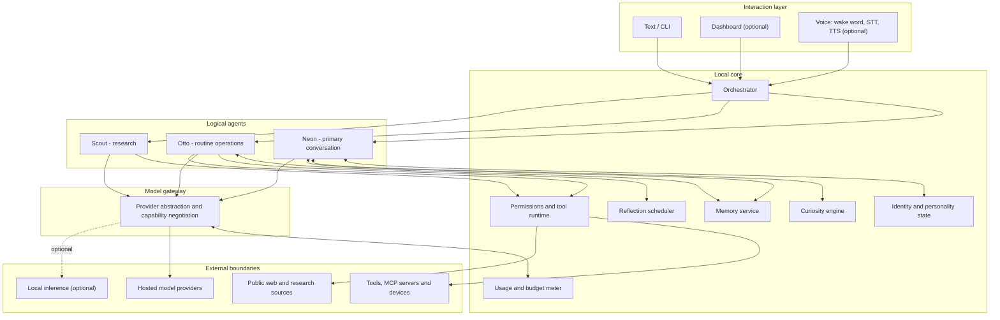
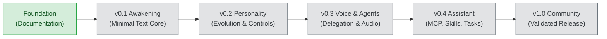

# Bunny.ai

**An open-source personal AI that grows with you.**

> **Project status: pre-release, documentation-only foundation.**
> This repository does not yet contain a runnable Bunny implementation. The documents
> here define the vision, principles, trust boundaries and proposed architecture; they do
> not claim that the capabilities described below are complete or validated.

---

## What is Bunny?

Bunny is an open-source, provider-agnostic personal assistant framework designed to run
on hardware you control.

Most modern AI assistants are rented from cloud platforms. Their personality, memory,
and capabilities live inside proprietary vendor accounts. When a model is deprecated, a
pricing structure changes, or terms of service shift, the assistant changes or vanishes
with it.

Bunny inverts this relationship:

> **Your hardware, your choice of intelligence, your memories, your Bunny.**

Bunny decouples the assistant's enduring identity and memory from the underlying
language model. The intelligence engine is treated as an interchangeable utility, while
your conversation history, preferences, and assistant identity remain stored safely on
your own device.

Bunny is designed for:

- **Individuals** who want an intelligent, personal assistant that respects their
  privacy, avoids recurring platform subscriptions, and cannot be altered or shut down
  by a remote vendor.
- **Tinkerers and developers** who want a modular, hackable foundation that runs on
  everyday hardware, supports local or hosted models, and enforces strict, deterministic
  security controls.

When development reaches release, users can expect a lightweight assistant that is
immediately useful via text, learns preferences naturally over time, and operates strictly
within configured budget and permission limits.

---

## What living with Bunny could feel like

> *The following scenarios are illustrative hypothetical interactions demonstrating
> future intended behaviour, not currently implemented software. Bunny is not conscious,
> sentient or emotionally dependent on its user; it is an attentive software tool designed
> to be helpful, transparent and respectful of your attention.*

### Learning your world through natural conversation

**First week:**
```text
User:  I've been thinking about getting into landscape photography on weekends.
Bunny: That sounds rewarding! The morning light can completely change a familiar place.
       Are you looking at dedicated cameras, or starting with your phone to see how you like it?
User:  Just my phone and a small tripod for now.
Bunny: That's plenty to learn composition and framing. Let me know if you want some simple
       guidance on golden-hour planning or rule-of-thirds techniques whenever you head out.
```

**Two weeks later:**
```text
User:  I have a free Saturday morning coming up. Any ideas for a quiet hike within an hour's drive?
Bunny: Blackwood Ridge is about 45 minutes west. It has an open eastern overlook that catches early
       morning light—and it's usually quiet before 9 AM, which might suit your landscape photos.
       Would you like the trail details and sunrise time for Saturday?
User:  That's spot on. Yes, please.
```

Bunny observed an interest, remembered it locally without intrusive questionnaires, and
surfaced a helpful suggestion when relevant—while leaving the decision entirely to the user.

### Proactive assistance with clear consent

```text
User:  Can you find out if high tide at Blackwood Creek coincides with sunrise this Saturday?
Bunny: I checked the tide charts for Saturday: high tide is at 6:18 AM, and sunrise is at 6:05 AM.
       The water levels will be high right at dawn.
       Would you like me to prepare a brief packing checklist for wet conditions, or set a reminder
       for Friday evening?
User:  Just the reminder for 8 PM Friday, thanks.
Bunny: Reminder set for 8:00 PM Friday: "Check gear and weather for Blackwood Creek sunrise."
```

Bunny answered the research question, suggested logical next steps, and acted only on what the
user explicitly approved.

---

## Vision and project origin

### Founder's note

> Bunny is named after a small stuffed rabbit from my childhood.
>
> That toy was neither complex nor sophisticated, but it was a constant: a familiar,
> comforting presence that remained through moves, changing rooms, and the passage of years.
>
> In computing, we routinely upgrade hardware, switch operating systems, and replace
> tools. With AI, however, the industry has asked users to anchor their memories and personal
> context inside proprietary platforms where continuity can be terminated at any moment.
>
> Bunny began from a desire to build an assistant with the enduring continuity of that childhood
> keepsake—a personal companion whose memory and identity remain entirely yours, regardless of
> which machine it runs on or which intelligence model powers it behind the scenes.

Bunny's goal is to bring that sense of reliable, permanent ownership to personal AI: an assistant
that is curious from day one, grows alongside you, and remains recognisably itself across models,
providers, and machines.

Read the complete [Vision statement](docs/VISION.md).

---

## What makes Bunny different

- **Ownership by design.** Identity, memories, configuration, and hardware belong to the
  user. Moving to another computer or switching model providers never means starting over.
- **Provider independence.** One supported API key is sufficient to begin. Users choose
  their preferred intelligence provider; local inference and multi-provider setups are
  optional enhancements, never prerequisites.
- **A personality with boundaries.** A stable core identity ([Layer 1](docs/PERSONALITY.md))
  is separated from an evolving conversational style ([Layer 2](docs/PERSONALITY.md)), which is
  separated again from knowledge about the user ([Layer 3](docs/PERSONALITY.md)). The adaptable
  layers are inspectable, editable, and reversible.
- **Curiosity as a subsystem.** Bunny notices useful gaps in its understanding and occasionally
  asks natural follow-up questions—without interrupting urgent tasks, nagging, or fabricating
  engagement.
- **Local-first memory.** Memory and identity are stored locally on your device, with explicit
  user control to inspect, correct, export, and delete. Cloud models only receive necessary,
  transparently disclosed context. Local storage is not the same as local inference.
- **Modest hardware, no GPU required.** Designed to run on modest, accessible hardware such as
  a Raspberry Pi 4 (4 GB RAM) or repurposed PC. Cloud-hosted models handle heavy inference unless
  local models are explicitly configured.
- **Deterministic safety and spending controls.** Permissions, tool execution, and budget
  limits are enforced by deterministic software code, never by easily bypassed prompt instructions.
- **Graceful degradation.** Different language models support different capabilities. Bunny
  adapts its features honestly to match the configured model rather than failing unpredictably.
- **No mandatory subscription.** There is no required Bunny cloud account, recurring service fee,
  or locked platform tier.

---

## Meet Neon, Otto and Scout

Bunny presents a single, cohesive assistant identity to the user. Internally, responsibilities
are divided among three planned **logical agent roles**:

```text
               +-------------------------------------------------+
               |                    BUNNY                        |
               |         (Unified Assistant Identity)            |
               +-------------------------------------------------+
                                       |
         +-----------------------------+-----------------------------+
         |                             |                             |
         v                             v                             v
+------------------+          +------------------+          +------------------+
|      NEON        |          |       OTTO       |          |      SCOUT       |
| Primary Dialogue |          | Routine & Memory |          | Research & Web   |
+------------------+          +------------------+          +------------------+
| - Conversational |          | - Background     |          | - Deep research  |
|   personality    |          |   reflection     |          | - Source finding |
| - User requests  |          | - Memory hygiene |          | - Web discovery  |
| - Task routing   |          | - Scheduled jobs |          | - Synthesis      |
+------------------+          +------------------+          +------------------+
```

- **Neon (Primary conversation and interaction):**
  Neon is the conversational voice and direct interface of Bunny. When you talk to Bunny,
  Neon listens, manages the conversation, responds with Bunny's personality, and decides
  whether a task can be answered directly or delegated.
- **Otto (Routine operations, memory hygiene and reflection):**
  Otto handles background housekeeping. Otto organizes and summarizes memories, cleans up
  stale context, schedules approved background tasks, and performs periodic reflection
  without interrupting your conversations.
- **Scout (Research and information discovery):**
  Scout is Bunny's investigator. When a task requires external documentation, technical
  synthesis, or deep web exploration, Scout gathers information through approved, sandboxed
  channels and reports findings back to Neon.

### Architectural safeguards for agent roles

- **Single identity:** To you, it is always just Bunny. Neon, Otto, and Scout are internal
  work divisions, not separate competing personalities.
- **Shared resources:** These are logical roles, not mandatory background processes or
  separate virtual machines. A single API key and a single configured model can easily serve
  all three roles.
- **Strict trust boundaries:** Otto and Scout cannot act independently in the outside world.
  All tool actions, web requests, and external interactions must pass through the deterministic
  permission layer and pre-dispatch budget meter. No agent can expand its own authority.

---

## Architecture at a glance

Bunny is structured as a compact local core surrounded by replaceable adapters. The diagram
below provides a simplified architectural overview.

The canonical architecture specification, trust boundaries, and component responsibilities are
maintained in [docs/ARCHITECTURE.md](docs/ARCHITECTURE.md).



The gateway, memory service, and permission layer represent absolute architectural boundaries:
no agent may bypass the budget meter or permission runtime, and no model output can grant itself
elevated authority.

---

## Hardware targets and operating costs

### Hardware targets

- **Reference target:** Raspberry Pi 4 (4 GB RAM, headless 64-bit Linux). This serves as our
  initial design constraint and benchmark target, not yet a validated minimum.
- **Supported environments (planned):** Repurposed laptops, desktops, mini PCs, and home servers
  running Linux, macOS, or Windows.
- **Voice interaction (optional):** Wake-word processing is planned to remain strictly local.
  Ambient audio is never uploaded continuously.
- **Local inference (optional):** Compatible small models can run locally where hardware and
  memory permit. No dedicated GPU is required to run Bunny when using hosted model providers.

### Operating costs

Understanding what Bunny costs to run is essential:

- **Bunny software:** 100% free and open-source under the Apache 2.0 licence. There are no software
  licence fees, subscriptions, or paywalled features.
- **Model provider API costs:** Hosted model providers (such as Anthropic, OpenAI, Google, etc.)
  charge for tokens processed by their APIs. Usage is paid directly to the provider you choose.
- **One key is enough:** You do not need multiple subscriptions or expensive setups. A single
  supported API key powers the entire experience.
- **Pre-dispatch budget safety:** Bunny treats spending limits as hard constraints. Every billable
  request reserves budget before dispatch against configured daily or monthly limits. Bunny stops
  and alerts you before exceeding your chosen budget.
- **Local inference costs:** While running a local model incurs no per-token API fees, it still
  requires compatible hardware, system RAM, and electrical power.

---

## Roadmap preview

Development is structured into phased milestones to ensure core identity, persistent memory,
and safety boundaries are thoroughly established before adding voice, tools, and background
autonomy.

For full milestone exit criteria, see [docs/ROADMAP.md](docs/ROADMAP.md).



### Milestone summary

- **Completed Foundation (Current state):**
  - Architectural blueprint, vision, trust boundaries, decision log ([D-001 through D-022](docs/DECISIONS.md)),
    and community standards.
- **Upcoming Implementation Milestones:**
  - **v0.1 — Awakening:** Minimal functional text assistant on reference hardware. Single API key
    setup, Neon conversational role, seed personality, basic local memory, restart persistence, and
    pre-dispatch budget verification ([D-013](docs/DECISIONS.md)).
  - **v0.2 — Growing Personality:** Structured Layer 2 personality evolution, user inspection and
    reversal controls, memory management, batch background reflection, and daily/monthly spending caps.
- **Longer-Term Planned Capabilities:**
  - **v0.3 — Voice and Delegation:** Local wake-word processing, optional speech-to-text and
    text-to-speech, Neon/Otto/Scout delegation envelopes, tool execution permissions, and the v0.3
    security review gate.
  - **v0.4 — Personal Assistant:** Model Context Protocol (MCP) integrations, installable skills,
    scheduled tasks and reminders, optional dashboard, and network egress/SSRF security gates.
  - **v1.0 — Community-Ready:** Cross-platform packaging, documented installation, verified extension
    interfaces, and comprehensive security audit.

*Note: Milestones are proposed goals without fixed delivery dates. Hardware targets and platform
compatibility remain unvalidated until tested during their respective implementation phases.*

---

## Documentation

The repository is thoroughly documented. Key reference files include:

| Document | Purpose |
|---|---|
| [Vision](docs/VISION.md) | Problem statement, principles, positioning, and non-goals |
| [Architecture](docs/ARCHITECTURE.md) | Canonical component specifications, agent roles, and trust boundaries |
| [Awakening](docs/AWAKENING.md) | First-run experience and seed personality design |
| [Personality](docs/PERSONALITY.md) | Three-layer identity model, evolution rules, and user controls |
| [Memory](docs/MEMORY.md) | Memory categories, storage schema, retrieval, and deletion rules |
| [Privacy](docs/PRIVACY.md) | Data flows, local vs. cloud context disclosure, and retention policies |
| [Roadmap](docs/ROADMAP.md) | Phased milestones, deliverables, and strict exit criteria |
| [Decisions](docs/DECISIONS.md) | Accepted, provisional, and open architectural decision log |
| [Contributing](CONTRIBUTING.md) | Contribution guidelines, pre-release design review process |
| [Code of Conduct](CODE_OF_CONDUCT.md) | Community participation standards and reporting guidelines |
| [Security](SECURITY.md) | Vulnerability disclosure policy and deterministic security model |

---

## Contributing

Bunny.ai is currently in its design and specification phase. We welcome thoughtful feedback,
architectural critique, and contributions regarding security, privacy, accessibility, and platform
design.

Please review [CONTRIBUTING.md](CONTRIBUTING.md) and [CODE_OF_CONDUCT.md](CODE_OF_CONDUCT.md) before
participating. When discussing features, please respect project privacy guidelines: never share real
API credentials, private infrastructure details, or personal data.

To report security vulnerabilities, please consult [SECURITY.md](SECURITY.md) for instructions on
using GitHub Private Vulnerability Reporting or direct maintainer contact.

---

## Licence

Bunny.ai documentation and software designs are licensed under the
[Apache License 2.0](LICENSE).

---

## Provenance

This repository is the public home of Bunny.ai. An earlier private prototype informed some of the
conceptual design, but no prototype source code or personal configuration has been imported.
All design documents in this repository are written from scratch for the open-source community
and contain no personal, proprietary, or credential data.
