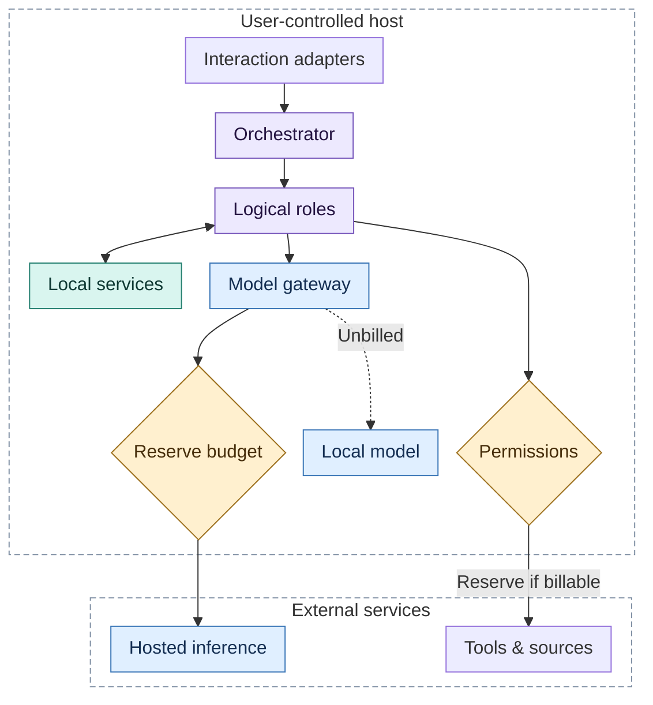
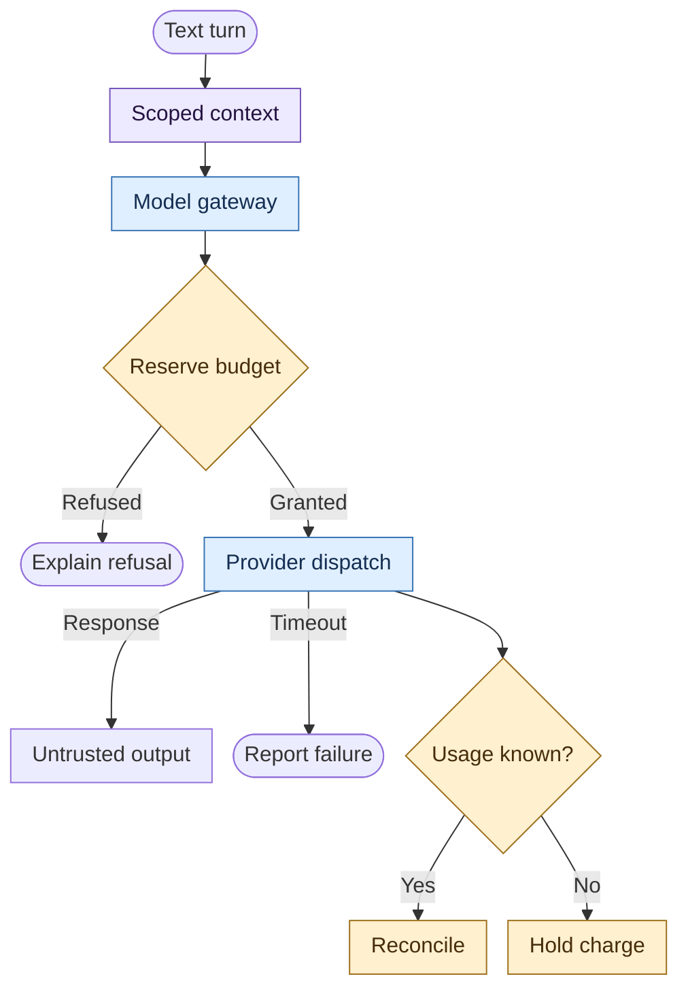
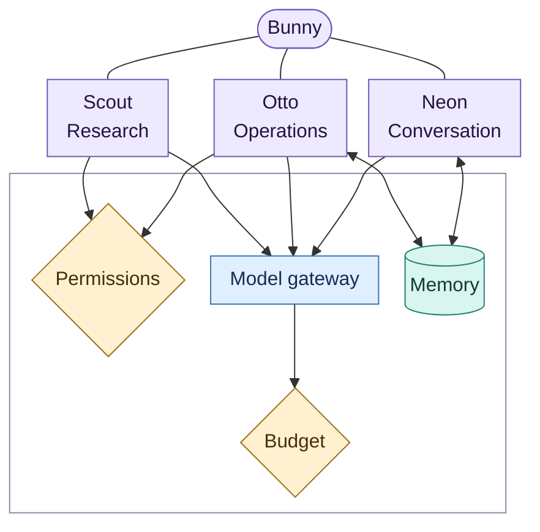

# Architecture

> **Status:** proposed design. Nothing in this document has been released or validated
> as a working system. Components are described as targets, not as current features.

Bunny is designed as a small local core with replaceable boundaries: a model gateway, a
memory service, a permission layer and a set of interaction adapters. The architecture
optimises for modest hardware, honest failure and portability of identity.

## Constraints

- Raspberry Pi 4, 4 GB RAM as the initial reference target, subject to testing.
- No mandatory GPU and no mandatory container runtime.
- One process may host several logical components initially.
- Text-first; voice and devices are optional layers.
- Local-first state, with explicit disclosure when context is sent to a hosted model.
- Strict separation between personal deployment configuration and reusable framework code.
- Every billable request passes through one accounting boundary.

## Component map

The component map below is the **canonical** architecture diagram for Bunny.ai. All
derived diagrams in other documents must preserve these edge semantics and component
boundaries.

Arrows show dependencies and admission conditions. The gateway dispatches the provider
request after approval from the meter. The local inference route still requires a
reservation if billable. Tool traffic goes through the permission runtime and all billable
attempts use the same accounting boundary. Local services cover identity, memory, curiosity and
reflection. The memory service reads and writes local storage. Neon uses identity,
curiosity and memory. Otto uses memory and coordinates reflection. The integration
wiring for billable non-model actions is unspecified. Configurations with an optional accelerator still have a distinct
accelerator trust boundary.

No agent or subsystem may bypass the permission layer to access tools, devices, or the
external web; similarly, no agent may dispatch billable inference without reserving against
the budget meter.

## Responsibilities

| Component | Responsibility | Must not |
|---|---|---|
| Interaction | Accept text, voice or dashboard input; present status and results. | Own identity, memory policy or permissions. |
| Orchestrator | Route a request to an agent, assemble bounded context, enforce cancellation and budgets. | Let an agent bypass the gateway or permission layer. |
| Identity and personality | Hold the stable core and the configurable evolving layers. | Be silently rewritten or replaced by a model. |
| Curiosity engine | Decide whether a natural follow-up question is useful and appropriate. | Block task completion, nag, or infer sensitive facts without consent. |
| Memory service | Store, retrieve, export, correct and delete user knowledge with provenance. | Treat every conversation as permanent memory. |
| Reflection scheduler | Consolidate memories and personality updates in bounded batches. | Make continuous calls, grant permissions or perform external actions. |
| Model gateway | Normalise provider access, capabilities, streaming, usage and errors. | Promise identical behaviour across all models. |
| Budget meter | Reserve, record and settle billable attempts; enforce limits. | Allow an unreserved paid request. |
| Permission layer | Enforce scoped tool, device and network egress access before effects. | Delegate authority to model text or bypass outbound SSRF filtering. |
| Storage | Persist local state durably with backup and migration paths. | Be described as encrypted or local-only unless it is. |

## Request lifecycle

The example follows a billable text turn. It leaves streaming timing and the relative
ordering of response delivery, history persistence and optional consolidation unspecified.

Bunny reports timeouts and disconnects to the user. The gateway reconciles reported
usage or holds uncertain charges. Bunny presents usable output through Neon and applies
the [permission rules](../SECURITY.md) before any proposed tool action takes effect.
A completed turn can be persisted subject to retention settings. Durable memory has its
own [consent and policy checks](MEMORY.md#lifecycle).

Key rules:

1. A request is bounded before it is sent.
2. A paid request is reserved before dispatch.
3. A model cannot approve its own tool call.
4. Uncertain charges remain recorded rather than silently released.
5. Failed or incomplete turns are not fabricated into history.

## Logical agents

The agents are logical roles, not necessarily separate processes, models or provider
accounts. A single configured model can serve all three where its capabilities permit.

| Agent | Role | Typical tools | Default posture |
|---|---|---|---|
| **Neon** | Primary conversation, personality, coordination and final presentation. | None initially; delegated results only. | Always the voice of Bunny when the user calls Bunny. |
| **Otto** | Routine operations, memory consolidation, background reflection, low-complexity tasks. | Narrow, allowlisted actions and schedulers. | Budgeted, event-driven, permission-scoped. |
| **Scout** | Research, public-source search, comparison, source attribution. | Restricted retrieval. | Untrusted source data; no shell or device control. |

Delegation is explicit and bounded. A child task inherits equal or narrower permissions,
its own budget reservation and a deadline. Bunny's final answer, when Bunny owns the
conversation, should use Bunny's configured model rather than quietly presenting a
worker's cheaper output as Bunny. Bunny's voice uses Neon's model configuration by default;
per-agent model overrides apply only when explicitly configured by the user.

The bottom group shows shared infrastructure. The memory service is infrastructure, not an agent. Wake-word detection, scheduling,
routing and metering are deterministic components, not additional LLM personas.

## Model gateway

The gateway exposes a provider-neutral interface and negotiates capabilities:

- Text generation and streaming where available.
- Structured output where supported.
- Tool calling where supported.
- Context limits and truncation policy.
- Usage accounting and cost estimation.
- Rate-limit, timeout and error normalisation.
- Optional fallback routing, only when explicitly configured.
- Local endpoints such as Ollama or compatible servers.
- Custom OpenAI-compatible endpoints.

Candidate integrations include OpenAI, Anthropic, Google Gemini, xAI, DeepSeek, Groq,
OpenRouter, local inference and custom endpoints. These are candidates, not claims of
existing support.

The gateway must represent capability differences honestly. A model without tool calling
should not be described as tool-capable. A provider without usage metadata should report
usage as unavailable rather than zero. A fallback must never silently change Bunny's
designated conversational model without the user's configuration.

### Gateway resilience and charge accounting

The gateway provides resilience against transient provider errors while protecting the
user's budget:

- **Bounded retry policy:** Retries are restricted to idempotent requests and transient
  provider failures (HTTP 429, 502, 503, 504). Non-retryable client errors (HTTP 400,
  401, 403, 422) fail immediately. Total attempts are strictly capped (default: maximum
  3 attempts).
- **Backoff and jitter:** Retries apply exponential backoff combined with randomized full
  jitter to prevent thundering herds against provider APIs.
- **Header honouring:** Provider-supplied `Retry-After` headers take precedence over
  default backoff schedules up to a configurable maximum wait ceiling.
- **Per-provider concurrency caps:** Active simultaneous requests to any single provider
  are capped in code to stay within confirmed provider rate tiers.
- **Uncertain-charge accounting:** When a request is dispatched over the network and times
  out or disconnects before a response is parsed, the preliminary reservation in the
  budget meter is held in an "uncertain" state rather than released as zero. Uncertain
  charges count against spending caps until reconciled with provider usage records or
  manually reviewed, preventing double-spending on retries.

### Pricing configuration and spending controls

The budget meter enforces economic boundaries through deterministic code checks (D-013):

- **Versioned price tables:** Pricing data is stored in versioned tables specifying
  provider, model ID, effective dates, input token cost, output token cost, and prompt
  cache pricing tiers.
- **Missing or stale pricing policy:** If a request targets a model or provider missing
  from the pricing table, or whose pricing configuration is expired, Bunny enforces a
  conservative deny or uses an explicit user-approved upper-bound ceiling. A billable
  request never proceeds under a silent zero-cost assumption.
- **Soft alerts versus hard caps:**
  - *Soft warnings:* Non-blocking notifications delivered through the interaction layer
    when accumulated spending crosses configured warning thresholds (e.g., 80% of daily
    budget).
  - *Hard spending caps:* Code-enforced barriers (daily, monthly, and per-request limits).
    The budget meter rejects pre-dispatch reservations when hard caps are reached,
    halting execution before any network request is issued.

## Runtime context engineering

The orchestrator and memory service coordinate context assembly to maintain relevance,
respect model context windows, and optimize API costs:

- **Composition order:** Context is assembled into prompt templates in strict priority
  layers:
  1. System preamble and Layer 1 core identity (immutable values, boundaries).
  2. Layer 2 evolving personality state (style, formality, tone).
  3. Layer 3 user understanding and scoped memory records (highest relevance first).
  4. Summarized past conversation context (compressed turns).
  5. Rolling active conversation turns (recent uncompressed history).
  6. Current user input, tool outputs, and attachments.
- **Layer budgets and quotas:** Each prompt layer is assigned a strict maximum token
  allocation. If context exceeds the target envelope, lower-priority memories and older
  uncompressed turns are truncated first; Layer 1 boundaries are never truncated.
- **Selective retrieval:** Memory retrieval is strictly bounded by relevance threshold,
  category filter, and token count. Explicit facts take precedence over inferred notes.
- **Summarisation triggers:** When active conversation history reaches a configurable
  watermark (e.g., 60% of the conversational history budget), Otto schedules a bounded
  background turn to compress older turns into a durable conversation summary, preserving
  fidelity while freeing context for immediate turns.
- **Cache-aware accounting:** The gateway and budget meter track prompt caching
  mechanisms (such as Anthropic prompt caching, OpenAI cached tokens, or DeepSeek prefix
  caching). Usage accounting differentiates cached read tokens from uncached input tokens,
  and cost estimation reflects provider cache discounts.

## Memory and identity

Memory is local-first and inspectable. SQLite is the initial candidate, with full-text
search considered before embeddings and a vector database avoided until measurements show
a need. The record model, categories, retrieval rules and deletion semantics are defined
in [MEMORY.md](MEMORY.md).

Identity is structured state, not a prompt alone. The three layers and their controls are
defined in [PERSONALITY.md](PERSONALITY.md). The first-run experience is defined in
[AWAKENING.md](AWAKENING.md).

## Background reflection

Reflection is batched or event-driven, not a continuous loop. Otto may coordinate a
bounded job that:

- Consolidates useful memories and removes redundant context.
- Flags contradictions and outdated information.
- Proposes personality updates for inspectable state.
- Identifies useful future questions.
- Prepares summaries with source references.

Reflection must not grant permissions, perform arbitrary external actions or run without
a budget. It supports configurable frequency, daily and monthly limits, manual-only mode
and a disabled mode. When a budget is exhausted, reflection suspends gracefully.

## Voice and devices

Voice is an optional pipeline: wake word, voice activity detection, speech-to-text,
orchestration, text-to-speech and output routing. Wake-word processing should preferably
run locally, and ambient audio must not be uploaded continuously.

Voice adds privacy obligations: a visible or audible listening indicator, a reliable mute,
bounded utterance buffers and configurable retention. The assistant must remain usable by
text and headless when voice is unavailable.

Device and smart-home integrations go through the permission layer with allowlisted
actions, explicit credentials and deterministic confirmation for consequential effects.

## Deployment modes

- **Headless:** text or voice on a small Linux host with no display.
- **Desktop:** local terminal or lightweight dashboard on a laptop or desktop.
- **Server:** an always-on host on the local network, with authenticated access only.
- **Hybrid:** core on a Raspberry Pi, optional acceleration on another machine, without
  making the accelerator mandatory.

No mode may require Docker, Redis, Kubernetes or a dedicated vector database. Those can be
optional deployment choices later if evidence justifies them.

## Failure behaviour

Bunny should fail honestly and locally:

- If the provider is unreachable, say so; do not substitute a different model silently.
- If the budget is exhausted, stop before dispatch and report the limit.
- If memory is unavailable, continue with reduced context and visible status.
- If voice fails, keep text available.
- If a tool is denied or unavailable, report the denial without inventing success.
- If a device is in an unknown state, treat it as unavailable rather than guessing.

## Trust boundaries

The user, household endpoints, local host, optional accelerator, external tools,
third-party services, model providers and retrieved internet content all have different
authority. A local network is not automatically trusted. External content is data, never
instruction. The security model is elaborated in [PRIVACY.md](PRIVACY.md) and
[SECURITY.md](../SECURITY.md).

### Network egress and SSRF protection

Tool integrations, MCP servers, and Scout's research functions operate under strict outbound
network constraints enforced by the permission runtime:

- **Destination validation:** Outbound IP addresses resolved by tools or research agents
  are checked against a deny-list of private, local, and sensitive network ranges (IPv4
  127.0.0.0/8, 10.0.0.0/8, 172.16.0.0/12, 192.168.0.0/16, 169.254.0.0/16; IPv6 `::1`,
  `fe80::/10`, `fc00::/7`).
- **Redirect revalidation:** HTTP redirect chains must be validated at every hop; a request
  that redirects from a public URL to an internal or link-local address is blocked.
- **DNS rebinding defence:** Resolved IP addresses are pinned for the socket connection to
  prevent time-of-check to time-of-use (TOCTOU) DNS rebinding attacks.
- **Payload limits:** Outbound fetch responses are constrained by hard response-size caps
  and connection timeouts to prevent denial-of-service or memory exhaustion on the host.

## Diagram conventions

Each view answers a different question: the [README](../README.md) introduces the product,
the component map shows service boundaries, and the role and lifecycle views show
responsibilities and request behaviour. [Personality](PERSONALITY.md#three-layers) and
[privacy](PRIVACY.md#data-flows) show state and data handling in more detail.

- **Violet** marks Bunny and its roles or core behaviour. **Teal** marks local state.
  **Blue** marks model access or inference. **Amber** marks a policy or budget decision.
  **Neutral** marks actors, interfaces and other endpoints.
- Rounded endpoints represent the user, cylinders represent storage or shared state, and
  diamonds represent checks enforced by software. Groups name trust boundaries.
- Keep node labels short and reserve edge labels for conditions or data that distinguish
  paths. Use dashed arrows for optional paths. Put qualifications next to the diagram.
- Use native Mermaid for technical views and pair each with a title and description.
  Use editable SVG for the README illustration, with Markdown alt text and no external
  assets. Check light and dark themes at desktop and phone widths.

## Open architecture questions

Technology stack, storage engine details, gateway interface shape, personality schema,
voice stack, event bus and packaging approach remain open. See
[DECISIONS.md](DECISIONS.md) for their current status and the evidence required to settle
them.
