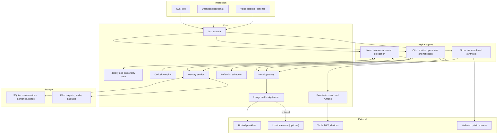
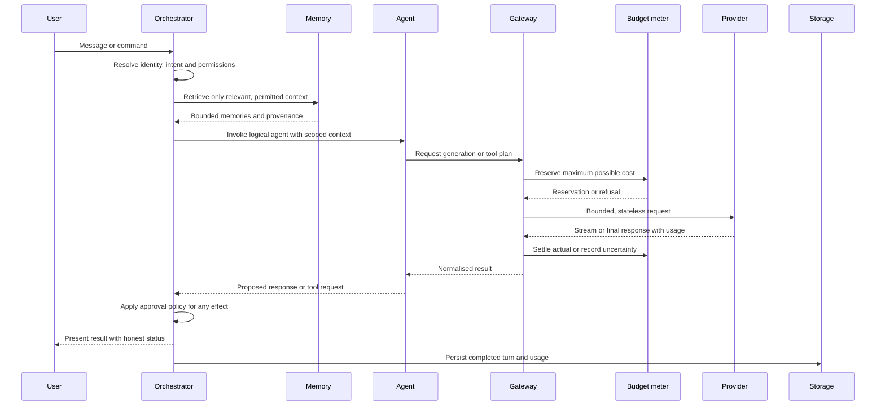

# Architecture

> **Status:** proposed design. Nothing in this document has been released or validated
> as a working system. Components are described as targets, not as current features.

Bunny is designed as a small local core with replaceable boundaries: a model gateway, a
memory service, a permission layer and a set of interaction adapters. The architecture
optimises for modest hardware, honest failure and portability of identity.

## Constraints

- Raspberry Pi 4, 4 GB RAM as the initial reference target, subject to testing.
- No mandatory GPU and no mandatory container runtime.
- One process may host several logical components initially.
- Text-first; voice and devices are optional layers.
- Local-first state, with explicit disclosure when context is sent to a hosted model.
- Strict separation between personal deployment configuration and reusable framework code.
- Every billable request passes through one accounting boundary.

## Component map

## Responsibilities

| Component | Responsibility | Must not |
|---|---|---|
| Interaction | Accept text, voice or dashboard input; present status and results. | Own identity, memory policy or permissions. |
| Orchestrator | Route a request to an agent, assemble bounded context, enforce cancellation and budgets. | Let an agent bypass the gateway or permission layer. |
| Identity and personality | Hold the stable core and the configurable evolving layers. | Be silently rewritten or replaced by a model. |
| Curiosity engine | Decide whether a natural follow-up question is useful and appropriate. | Block task completion, nag, or infer sensitive facts without consent. |
| Memory service | Store, retrieve, export, correct and delete user knowledge with provenance. | Treat every conversation as permanent memory. |
| Reflection scheduler | Consolidate memories and personality updates in bounded batches. | Make continuous calls, grant permissions or perform external actions. |
| Model gateway | Normalise provider access, capabilities, streaming, usage and errors. | Promise identical behaviour across all models. |
| Budget meter | Reserve, record and settle billable attempts; enforce limits. | Allow an unreserved paid request. |
| Permission layer | Enforce scoped tool and device access before effects. | Delegate authority to model text. |
| Storage | Persist local state durably with backup and migration paths. | Be described as encrypted or local-only unless it is. |

## Request lifecycle

Key rules:

1. A request is bounded before it is sent.
2. A paid request is reserved before dispatch.
3. A model cannot approve its own tool call.
4. Uncertain charges remain recorded rather than silently released.
5. Failed or incomplete turns are not fabricated into history.

## Logical agents

The agents are logical roles, not necessarily separate processes, models or provider
accounts. A single configured model can serve all three where its capabilities permit.

| Agent | Role | Typical tools | Default posture |
|---|---|---|---|
| **Neon** | Primary conversation, personality, coordination and final presentation. | None initially; delegated results only. | Always the voice of Bunny when the user calls Bunny. |
| **Otto** | Routine operations, memory consolidation, background reflection, low-complexity tasks. | Narrow, allowlisted actions and schedulers. | Budgeted, event-driven, permission-scoped. |
| **Scout** | Research, public-source search, comparison, source attribution. | Restricted retrieval. | Untrusted source data; no shell or device control. |

Delegation is explicit and bounded. A child task inherits equal or narrower permissions,
its own budget reservation and a deadline. Bunny's final answer, when Bunny owns the
conversation, should use Bunny's configured model rather than quietly presenting a
worker's cheaper output as Bunny.

The memory service is infrastructure, not an agent. Wake-word detection, scheduling,
routing and metering are deterministic components, not additional LLM personas.

## Model gateway

The gateway exposes a provider-neutral interface and negotiates capabilities:

- Text generation and streaming where available.
- Structured output where supported.
- Tool calling where supported.
- Context limits and truncation policy.
- Usage accounting and cost estimation.
- Rate-limit, timeout and error normalisation.
- Optional fallback routing, only when explicitly configured.
- Local endpoints such as Ollama or compatible servers.
- Custom OpenAI-compatible endpoints.

Candidate integrations include OpenAI, Anthropic, Google Gemini, xAI, DeepSeek, Groq,
OpenRouter, local inference and custom endpoints. These are candidates, not claims of
existing support.

The gateway must represent capability differences honestly. A model without tool calling
should not be described as tool-capable. A provider without usage metadata should report
usage as unavailable rather than zero. A fallback must never silently change Bunny's
designated conversational model without the user's configuration.

## Memory and identity

Memory is local-first and inspectable. SQLite is the initial candidate, with full-text
search considered before embeddings and a vector database avoided until measurements show
a need. The record model, categories, retrieval rules and deletion semantics are defined
in [MEMORY.md](MEMORY.md).

Identity is structured state, not a prompt alone. The three layers and their controls are
defined in [PERSONALITY.md](PERSONALITY.md). The first-run experience is defined in
[AWAKENING.md](AWAKENING.md).

## Background reflection

Reflection is batched or event-driven, not a continuous loop. Otto may coordinate a
bounded job that:

- Consolidates useful memories and removes redundant context.
- Flags contradictions and outdated information.
- Proposes personality updates for inspectable state.
- Identifies useful future questions.
- Prepares summaries with source references.

Reflection must not grant permissions, perform arbitrary external actions or run without
a budget. It supports configurable frequency, daily and monthly limits, manual-only mode
and a disabled mode. When a budget is exhausted, reflection suspends gracefully.

## Voice and devices

Voice is an optional pipeline: wake word, voice activity detection, speech-to-text,
orchestration, text-to-speech and output routing. Wake-word processing should preferably
run locally, and ambient audio must not be uploaded continuously.

Voice adds privacy obligations: a visible or audible listening indicator, a reliable mute,
bounded utterance buffers and configurable retention. The assistant must remain usable by
text and headless when voice is unavailable.

Device and smart-home integrations go through the permission layer with allowlisted
actions, explicit credentials and deterministic confirmation for consequential effects.

## Deployment modes

- **Headless:** text or voice on a small Linux host with no display.
- **Desktop:** local terminal or lightweight dashboard on a laptop or desktop.
- **Server:** an always-on host on the local network, with authenticated access only.
- **Hybrid:** core on a Raspberry Pi, optional acceleration on another machine, without
  making the accelerator mandatory.

No mode may require Docker, Redis, Kubernetes or a dedicated vector database. Those can be
optional deployment choices later if evidence justifies them.

## Failure behaviour

Bunny should fail honestly and locally:

- If the provider is unreachable, say so; do not substitute a different model silently.
- If the budget is exhausted, stop before dispatch and report the limit.
- If memory is unavailable, continue with reduced context and visible status.
- If voice fails, keep text available.
- If a tool is denied or unavailable, report the denial without inventing success.
- If a device is in an unknown state, treat it as unavailable rather than guessing.

## Trust boundaries

The user, household endpoints, local host, optional accelerator, external tools,
third-party services, model providers and retrieved internet content all have different
authority. A local network is not automatically trusted. External content is data, never
instruction. The security model is elaborated in [PRIVACY.md](PRIVACY.md) and
[SECURITY.md](../SECURITY.md).

## Open architecture questions

Technology stack, storage engine details, gateway interface shape, personality schema,
voice stack, event bus and packaging approach remain open. See
[DECISIONS.md](DECISIONS.md) for their current status and the evidence required to settle
them.
