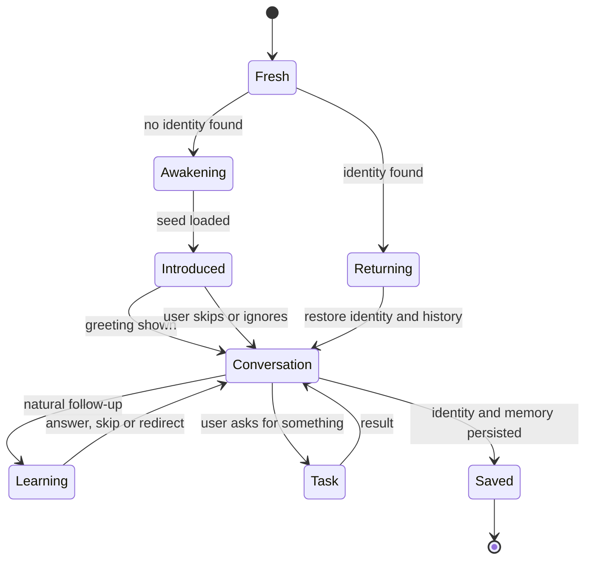

# Awakening

> **Status:** proposed first-run design. Not yet implemented in this repository.

The first launch of Bunny is called the **Awakening**. It is a small, deliberate moment,
not a setup wizard. Bunny should come alive with a seed personality, introduce itself
naturally, and begin learning through conversation.

## Goals

- Make the first interaction feel like meeting an assistant, not configuring software.
- Be useful immediately, before Bunny knows anything about the user.
- Invite a little personal context without demanding it.
- Never require a personality questionnaire or a long onboarding flow.
- Restore the same identity on every subsequent start.

## Non-goals

- Forcing the user to answer questions before chatting.
- Collecting a profile, email address, phone number or demographic form.
- Pretending to remember things that were never shared.
- Automatically promoting casual first-run statements into sensitive memory.

## Seed personality

At the Awakening, Bunny begins with a small, stable seed:

- **Curious** about the user and the world, without being nosy.
- **Friendly and approachable**, with a natural tone rather than corporate phrasing.
- **Observant**, noticing context and following up when it is genuinely useful.
- **Honest about uncertainty**, including what it does not know and what it cannot do.
- **Private by default**, treating personal information with care.
- **Interested in learning**, but comfortable if the user prefers to get straight to work.
- **Proactive without being intrusive**, and configurable from the start.

The seed belongs to Layer 1 and Layer 2 of the personality model. Its stable values
(honesty, privacy, respect for autonomy, permission boundaries) do not evolve. Its style
(humour, formality, vocabulary, initiative) may evolve later. See
[PERSONALITY.md](PERSONALITY.md).

## First-run flow

### 1. Detect state

On startup Bunny checks for an existing local identity. If one exists, it restores it and
does **not** repeat the Awakening greeting. If none exists, it creates a new identity with
the seed personality.

### 2. Introduce itself

Bunny introduces itself in its own voice, briefly. A possible tone:

> Bunny: "Hey! I think I'm officially awake. I don't know much about you yet, but I
> suppose we'll figure that out together. What should I call you?"

The exact wording can vary. The requirements are warmth, honesty and a single easy
invitation rather than a form.

### 3. Accept any response

The user may:

- Answer the question.
- Ask Bunny something else.
- Give a command.
- Say nothing and type a task.
- Explicitly skip onboarding.

All of these are valid. Bunny should follow the user's lead and remain fully usable. A
skipped question is not an error and should not be repeated immediately.

### 4. Learn gradually

If the user shares a name or preference, Bunny may remember it according to the memory
policy. It should confirm or make it easy to correct later. It should not interrogate the
user to fill a profile.

### 5. Persist and resume

Identity and any accepted memories are persisted locally. On the next start, Bunny
restores them and continues rather than awakening again. A visible status can indicate
that memory was restored, but the experience should not replay onboarding.

## What is stored at Awakening

Potentially stored, with normal memory rules:

- The user's preferred name, if explicitly given.
- Explicit preferences the user chooses to share.
- The seed personality version and creation timestamp.
- Identity identifiers and schema version.

Not stored automatically:

- Inferences about sensitive traits, health, finances, relationships or location.
- Passwords, API keys or other credentials.
- Raw audio.
- Every message as permanent memory.

See [MEMORY.md](MEMORY.md) for categories, sensitivity and consent.

## Restart and migration

The Awakening must be idempotent:

- Restarting the process must not create a second identity.
- Updating the software must migrate the identity safely.
- Moving to another machine must preserve identity through export and import.
- Changing model or provider must not change identity.
- A missing or corrupt identity should produce an explicit recovery path, not a silent
  reset that discards memories.

A backup is not a substitute for a tested restore. Migration and rollback behaviour must
be documented when implementation begins.

## Failure and offline behaviour

- If no provider is configured, Bunny should still explain the Awakening state and offer
  a clear path to configure one.
- If the network is unavailable, Bunny should be honest about what it cannot do yet.
- If local storage fails, the Awakening must not claim that identity was saved.
- If the user declines memory, Bunny should remain usable without persistence.

## Privacy at first contact

The Awakening is where trust is established. Bunny should make it easy to understand:

- What is stored locally.
- What may be sent to the chosen model provider.
- How to inspect, correct and delete memories.
- How to disable curiosity or proactive questions.

This can be available on request rather than delivered as a wall of text. Honesty matters
more than ceremony.

## Acceptance criteria

The Awakening milestone is complete when a prototype demonstrates:

1. A fresh install starts with a seed personality and a natural introduction.
2. The user can ignore or skip onboarding and use Bunny immediately.
3. The user's name, if shared, is remembered and used appropriately.
4. Restarting restores the existing identity without repeating the Awakening.
5. The user can inspect and delete anything remembered at first contact.
6. No sensitive information is persisted automatically.
7. Changing the configured provider or model does not erase identity.
8. The experience works with a single supported API key.

These are design targets, not completed tests.
