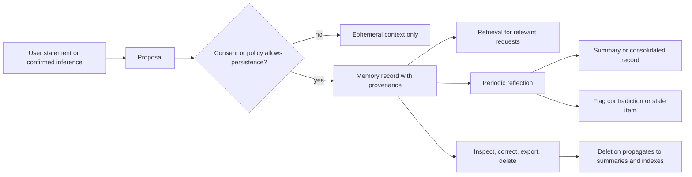

# Memory

> **Status:** proposed design. Not yet implemented in this repository.
>
> **Implemented subset:** the offline CLI scaffold stores only explicit, user-confirmed
> facts (`preferred_name` and `preference`) and supports inspect, correct, delete, reset,
> disable, bounded retrieval and a versioned unencrypted export/import. Inference,
> embeddings, summaries, hosted providers and encryption are not implemented. See
> [PORTABILITY.md](PORTABILITY.md).

Bunny's memory is local-first, inspectable and user-controlled. Memory is what allows
Bunny to grow, but it is also the most sensitive part of the system. The design therefore
separates conversation history, durable memory, derived summaries and ephemeral context.

## Principles

- **Local-first:** durable memory lives on the user's hardware.
- **Explicit over implicit:** users can see, correct and delete what is remembered.
- **Provenance always:** every record says where it came from and whether it was stated or
  inferred.
- **Minimum necessary:** store what is useful, not everything that was said.
- **Sensitivity-aware:** sensitive information requires stronger consent and retention.
- **Deletion is honest:** deleting a record is not the same as secure erasure or retracting
  data already sent to a provider.
- **Portable:** memory can be exported and imported without losing meaning.

Local storage does **not** mean local inference. When a hosted model is used, selected
context is transmitted to that provider. See [PRIVACY.md](PRIVACY.md).

## Categories

| Category | Examples | Typical source | Default retention |
|---|---|---|---|
| Preferences | Preferred name, tone, tools, food, schedule style | Explicit | Until changed or deleted |
| Episodic memories | A meaningful event or decision | Explicit or confirmed inference | Configurable, often months |
| Projects | Active repositories, goals, deadlines | Explicit | Until archived or deleted |
| Routines | Working hours, quiet hours, recurring habits | Explicit or inferred | Review periodically |
| Long-term goals | Learning plans, health-adjacent goals, career aims | Explicit | Sensitive review required |
| Conversation summaries | Condensed history for continuity | Derived | Configurable |
| Personality state | Trait values and preferences | Derived or explicit | Versioned |
| Pending tasks | Reminders and follow-ups | Explicit | Until completed or expired |
| Agent notes | Scoped scratch context for Scout or Otto | Derived | Short, often session-scoped |

Sensitive categories such as health, finances, relationships, precise location and
identity documents are not automatically persisted. They require explicit intent,
clear disclosure and a retention choice.

## Record model

Every durable memory should carry at least:

| Field | Purpose |
|---|---|
| `id` | Stable unique identifier. |
| `category` | One of the categories above. |
| `content` | The remembered statement, in structured or plain form. |
| `source` | Conversation, explicit command, import, reflection, or tool. |
| `provenance` | Message or record references, where available. |
| `created_at` | Creation timestamp. |
| `updated_at` | Last modification timestamp. |
| `confirmed_at` | Last time the user confirmed it. |
| `confidence` | Confidence for inferred records; explicit records are marked as such. |
| `explicit` | Whether the user stated it directly. |
| `sensitivity` | Normal, personal, sensitive, restricted. |
| `retention` | Policy or expiry. |
| `status` | Active, archived, pending review, redacted. |

Example, fictional:

```json
{
  "id": "mem_example_001",
  "category": "preference",
  "content": "Prefers concise answers in the morning.",
  "source": "conversation",
  "provenance": ["conv_example:turn_12"],
  "created_at": "2026-01-01T09:00:00Z",
  "updated_at": "2026-01-01T09:00:00Z",
  "confirmed_at": null,
  "confidence": 1.0,
  "explicit": true,
  "sensitivity": "personal",
  "retention": "until_deleted",
  "status": "active"
}
```

## Storage

SQLite is the initial candidate, not a mandatory decision. It is small, mature,
cross-platform, transactional and adequate for structured records and full-text search.

Order of preference:

1. Structured tables with explicit fields.
2. SQLite full-text search for retrieval.
3. Embeddings or a vector store only if measurements show that full-text search is
   insufficient.

Avoid mandatory Redis, a separate database server or Kubernetes. A single embedded store
keeps installation and backup simple on a Raspberry Pi.

Files such as exports, audio buffers and backups live outside the database with restrictive
permissions. Database encryption at rest is a longer-term goal; until then, documentation
must not describe the store as encrypted.

## Lifecycle



## Retrieval

Retrieval must be bounded and relevant:

- Prefer recent, high-confidence, explicit records.
- Scope by category and agent.
- Respect sensitivity and the current conversation.
- Never send the entire memory store to a hosted model.
- Distinguish "what the user told me" from "what I inferred".
- Permit the user to see which memories influenced a response, where practical.

Initially, retrieval can be deterministic: selected facts, category filters and full-text
search. Semantic retrieval is an optional later enhancement, not a prerequisite.
Retrieved records must fit within the strict token quota allocated to Layer 3 context
in the runtime context engineering budget (see [ARCHITECTURE.md](ARCHITECTURE.md)).

## Explicit versus inferred

| Explicit | Inferred |
|---|---|
| Stated by the user. | Derived by Bunny. |
| High default confidence. | Confidence must be recorded. |
| May be stored with normal consent. | Requires a higher bar. |
| Easy to quote and correct. | Should be presented as an inference. |
| Sensitive items still need care. | Sensitive inferences should not be stored automatically. |

A single ambiguous remark should not become a permanent fact. Repeated evidence or user
confirmation can raise confidence. The user must always be able to say "that is wrong"
and remove it.

## Deletion and correction

Users must be able to inspect, correct, delete, export and disable memory.

Deletion should propagate, where applicable, to:

- The primary record.
- Derived summaries and profiles.
- Search indexes and embeddings.
- Caches used for retrieval.
- Agent-specific copies.

Deletion cannot guarantee:

- Removal from conversation history or terminal scrollback.
- Removal from backups already taken.
- Removal from a provider's systems after a request was sent.
- Secure erasure from SQLite files or storage media.
- Removal from logs that were explicitly retained for accounting or security.

These limits must be documented in the interface, not buried. Backups should have their
own retention and deletion guidance.

## Export and import

Memory and identity should be exportable in a documented, versioned format. The
longer-term target is an encrypted export that can migrate to another machine without
exposing memories to the destination in plain text.

Import must:

- Validate the schema and version.
- Avoid silent overwrites of newer data.
- Preserve provenance where possible.
- Be reversible or backed up before applying.

Encryption and key management are open design questions. Do not claim encryption until it
exists and is tested.

## Background consolidation

Reflection may merge duplicates, summarise long histories and flag contradictions. It
must:

- Use bounded batches, not continuous calls.
- Trigger history summarisation when active turns cross the context threshold (e.g. 60%
  of the conversational history budget per [ARCHITECTURE.md](ARCHITECTURE.md)).
- Respect budgets and suspension.
- Never create new permissions or external effects.
- Keep source references for derived records.
- Allow the user to inspect and undo changes.
- Avoid turning deleted facts back into new memories.

Summaries are derived convenience, not authoritative evidence. If a summary conflicts with
the source, the source and the user's correction win.

## Provider disclosure

When a hosted model is used, Bunny sends only the context needed for the request. That
context may include selected memories. The interface should make this understandable:

- What was included.
- Which provider received it.
- Whether it was stored by the provider under its own policy.

Bunny cannot promise provider-side deletion. It can minimise what is sent and be honest
about the boundary.

## Open questions

- Exact schema, migration strategy and versioning rules.
- Which categories are on by default and which require opt-in.
- Retention defaults and how to surface them without nagging.
- Whether full-text search is sufficient before adding embeddings.
- Encryption format, key storage and recovery.
- How to test deletion propagation reliably.
- How memory should be scoped between Neon, Otto and Scout.

See [DECISIONS.md](DECISIONS.md) for status.
