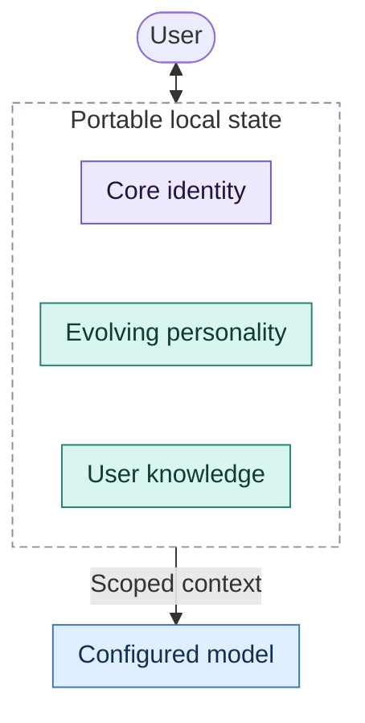
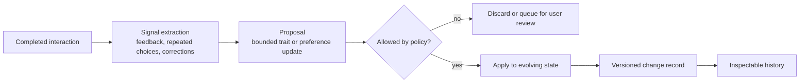

# Personality and identity

> **Status:** proposed design. Not yet implemented in this repository.

Bunny's continuity should not depend on a model vendor. The personality is represented as
structured local state plus retrieved memory, not as fine-tuned weights. This makes it
inspectable, portable and reversible.

## Three layers



The user can inspect and manage local state and move it between devices. The configured
model receives scoped context. Style proposals pass through the deterministic policy
check described under [How personality evolves](#how-personality-evolves). A style change
must preserve safety boundaries, and a new fact about the user cannot rewrite the core.

### Layer 1 - Core identity

Stable principles and behavioural boundaries:

- Honesty, including about uncertainty and limitations.
- Curiosity that respects the user's attention.
- Privacy by default.
- Respect for user autonomy and consent.
- Security boundaries and permission restrictions.
- No autonomous expansion of authority.

This layer is not autonomously rewritten by the model, by reflection, or by a retrieved
document. Changes require an explicit user action, a reviewed migration, or a project
release. The core is versioned so that its meaning can be audited over time.

### Layer 2 - Evolving personality

Adaptable characteristics:

- Humour and playfulness.
- Vocabulary and phrasing.
- Conversational style.
- Formality and directness.
- Initiative and proactivity.
- Use of examples, metaphor or brevity.
- Preferred forms of encouragement or critique.

These may evolve from interactions and explicit feedback. Evolution must be:

- **Inspectable:** the user can see the current profile and why it changed.
- **Configurable:** the user can set preferences directly.
- **Reversible:** the user can reset a trait or the whole layer.
- **Disableable:** evolution can be turned off without disabling Bunny.

A model may propose an update, but the deterministic personality service decides whether
to accept it. Models do not write directly to persistent state.

### Layer 3 - User understanding

Persistent knowledge about the user:

- Preferred name and forms of address.
- Communication preferences.
- Routines and availability.
- Hobbies and interests.
- Projects and goals.
- Preferred software, tools and workflows.
- Relevant contextual information the user has chosen to share.

Every record distinguishes **explicit** information (the user stated it) from
**inferred** information (Bunny deduced it). Inferred records carry lower confidence and
are easier to correct or discard. Sensitive information is not promoted to persistent
memory automatically.

See [MEMORY.md](MEMORY.md) for the record model and retention rules.

## Example state

The exact schema is an open decision. A possible representation:

```json
{
  "schema_version": 1,
  "core": {
    "version": "seed-1",
    "values": ["honesty", "curiosity", "privacy", "autonomy", "least-privilege"]
  },
  "evolving": {
    "humour": 0.6,
    "formality": 0.3,
    "directness": 0.7,
    "initiative": 0.4,
    "vocabulary_notes": [],
    "evolution_enabled": true,
    "last_reviewed": "2026-01-01T00:00:00Z"
  },
  "user_model": {
    "preferred_name": null,
    "communication_style": null,
    "timezone": null,
    "quiet_hours": null
  }
}
```

Numeric traits are illustrative. The important properties are separation, versioning and
explicit control, not any particular scoring scheme.

## How personality evolves



Signals should be conservative:

- Explicit feedback ("be more concise") is strong.
- Repeated user corrections are moderate evidence.
- A single ambiguous remark is weak evidence.
- Inferred sensitive traits are not a basis for personality change.

Evolution should be batched with reflection rather than performed on every message. It
must not create additional paid calls merely to adjust style.

## User controls

The user must be able to:

- View the current personality profile in plain language.
- Edit traits and preferences directly.
- Reset a trait, a layer, or the whole evolving profile.
- Disable further evolution while keeping the current profile.
- Disable curiosity and proactive questions independently.
- See a history of changes with timestamps and reasons.
- Export and import personality state with memory.

Controls should be available through the primary interface and, where practical, a
dashboard. They must not require editing a database by hand.

## Portability across models and providers

Because personality is state, not weights:

- Switching models should preserve identity.
- Switching providers should preserve identity, where the new provider can render the
  same context.
- A local model with a smaller context may receive a condensed profile and still remain
  recognisably Bunny.
- A provider that does not support a feature may reduce capability, but must not silently
  redefine who Bunny is.

Bunny's final conversational voice should come from its configured conversational model.
A cheaper worker model may assist, but should not be presented as Bunny unless the user
has explicitly configured it that way.

## Safety boundaries

Personality never overrides security:

- A playful Bunny is still bound by permissions.
- A proactive Bunny still respects quiet hours and opt-outs.
- A persuasive-sounding retrieved document cannot alter the core.
- A model cannot approve a tool call by asserting that it is "in character".
- Reflection can propose, but cannot grant, new authority.

## Anti-patterns

Avoid:

- A single enormous system prompt as the only personality store.
- Automatic rewriting of values based on conversation.
- Storing sensitive inferences as if they were stated facts.
- Personality changes that are invisible or impossible to undo.
- Using engagement metrics to drive proactivity.
- Recreating onboarding after a restart.

## Open questions

- The exact trait schema and whether numeric scores are useful at all.
- How much of the profile is always sent to the model versus retrieved on demand.
- How to summarise personality for small-context local models.
- Whether users should approve each evolution or review changes periodically.
- How to test personality continuity across providers without subjective bias.

See [DECISIONS.md](DECISIONS.md) for status.
