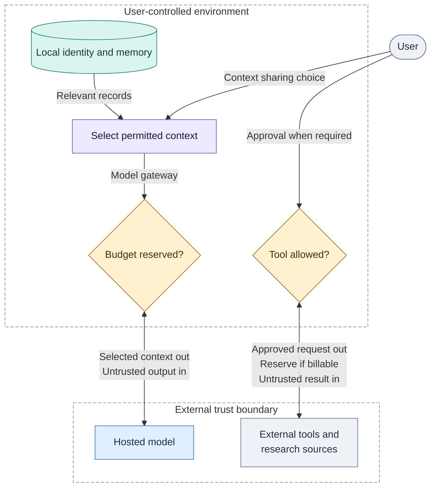

# Privacy

> **Status:** proposed design. Not yet implemented in this repository.

Bunny holds personal context, so privacy is a core product requirement. The design goal is
not "everything stays local" - that would be false when a hosted model is used. The goal is
to minimise collection, be clear about data flows, and give the user meaningful control.

## Local-first, not local-only

- **Local-first:** durable memory, identity, configuration and usage records live on the
  user's hardware.
- **Not local-only:** when a hosted model is used, selected context is sent to that
  provider. Local storage does not prevent that.
- **Optional local inference:** users may choose a local model so that inference also
  stays on their hardware, subject to capability and performance.

Bunny must never describe cloud inference as private merely because its memory is local.

## Data flows

This view follows hosted inference and external tool or research traffic. The arrows show
admission conditions and the data crossing each boundary. Treat model output and retrieved
content as untrusted data. If either leads to a proposed action, the permission runtime checks
scope, egress and any required user approval before execution. Billable tool actions require the same
pre-dispatch accounting boundary as hosted inference. Local inference and optional audio
are described separately.

| Data | Where it lives | May leave the device | Control |
|---|---|---|---|
| API keys and tokens | Secure secret storage or environment | Only to the selected provider as authentication | User-managed; never stored as memory |
| Conversation history | Local database | Selected recent turns may be sent to the model | Configurable history and context |
| Durable memories | Local database | Selected memories may be included in a request | Inspect, correct, delete, disable |
| Personality state | Local configuration | May be rendered into the system context | Inspect, edit, reset, disable evolution |
| Usage records | Local database | Not normally sent | Visible to the user; retention configurable |
| Audio buffers | Local memory or temporary files | Only after wake activation, if a cloud STT is chosen | Mute, retention and provider choice |
| Logs | Local files | Not normally sent | Redacted, bounded retention |
| Exports and backups | User-chosen location | Only where the user moves them | Encrypt and protect |

## Defaults

- No telemetry or analytics by default.
- No remote account required.
- No background upload of ambient audio.
- No automatic extraction of sensitive facts into memory.
- Proactive questions off or conservative until the user opts in.
- Logs redact credentials, memory values and message content where possible.
- Network services bind to loopback unless explicitly configured otherwise.

## User controls

The user must be able to:

- See what is stored and why.
- Inspect the memory and personality records that influenced a response.
- Correct or delete a record.
- Disable memory persistence for a conversation or globally.
- Disable curiosity, proactive questions and background reflection.
- Choose the provider and model.
- Choose whether context is sent at all for a given request.
- Export and import memory and identity.
- Delete conversation history separately from durable memory.
- Set retention periods for conversations, summaries, logs and audio.

Controls should be understandable without editing configuration files by hand.

## Retention and deletion limits

Deletion is a user right, but it has honest limits:

- Deleting a memory removes it from future retrieval and, where implemented, summaries and
  indexes.
- It may not remove earlier conversation turns, terminal scrollback or exported copies.
- It may not remove data already transmitted to a model provider.
- It may not remove data from backups until those backups expire or are deleted.
- SQLite deletion is not secure erasure; filesystem remnants may persist.
- Accounting or security logs may be retained for a defined period.

The interface must state these limits rather than implying perfect erasure. Backup
retention and provider policies are separate controls.

## Voice privacy

If voice is enabled:

- Wake-word detection should preferably run locally.
- Audio should be buffered only after activation, not continuously uploaded.
- A visible or audible indicator should show when the microphone is active.
- A hardware or software mute should be reliable and obvious.
- Raw audio retention should default to minimal or none.
- Diagnostic recordings require deliberate opt-in and a retention period.
- Shared spaces need care: a household speaker or television is not a private surface.

## Logging and audit

- Log security-relevant events with redacted metadata, not raw prompts or memories.
- Bound log size and retention.
- Provide a way to inspect and delete logs without erasing required accounting records.
- Never log API keys, authorization headers, memory values, transcripts or personal
  identifiers unless explicitly required and protected.

## Exports and backups

- Exports are sensitive and should be protected by the user.
- The longer-term target is an encrypted, versioned export for migration.
- Backups should be documented, testable and restorable.
- Restoring an old backup must not silently overwrite newer memory.
- Deleting data should include guidance for existing backups.

## Children, households and shared devices

Bunny is not designed for covert monitoring. If deployed in a shared household:

- The owner should inform other people who may be recorded or discussed.
- Shared output surfaces should not reveal private transcripts by default.
- Separate profiles or scoped memories are a possible future feature, not a current claim.
- Microphone and retention settings should be easy to review.

## Threat model summary

The full security model is in [SECURITY.md](../SECURITY.md). Privacy-relevant threats
include:

- Accidental disclosure of memories to a model provider or shared device.
- Prompt injection causing exfiltration through a tool or response.
- Local compromise of an unencrypted database.
- Over-broad backups or exports.
- Retention that outlives the user's intent.
- A provider changing its data policy.

Mitigations include data minimisation, explicit consent, local wake processing, redacted
logs, restrictive file permissions, scoped tool permissions and honest disclosure.

## Open questions

- Encryption at rest and key recovery.
- Exact default retention for conversations, summaries and audio.
- Whether a "private mode" request should bypass hosted models entirely.
- How to represent household profiles without leaking between them.
- How to prove deletion propagation in tests.
- Which optional hosted services, if any, would ever be acceptable.

See [DECISIONS.md](DECISIONS.md) for status.
